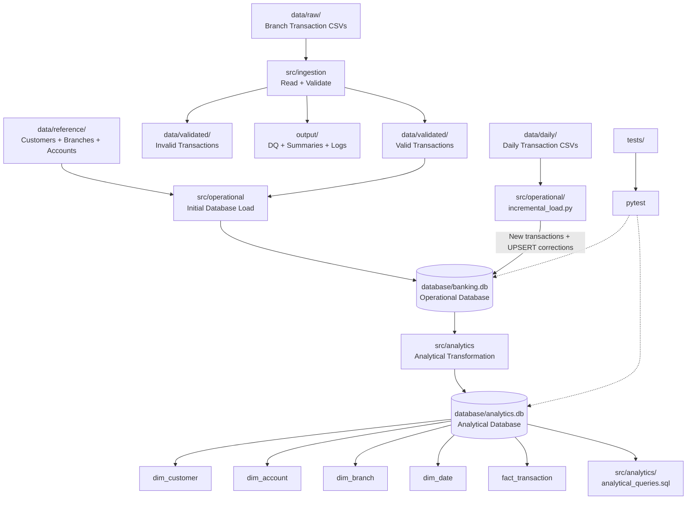
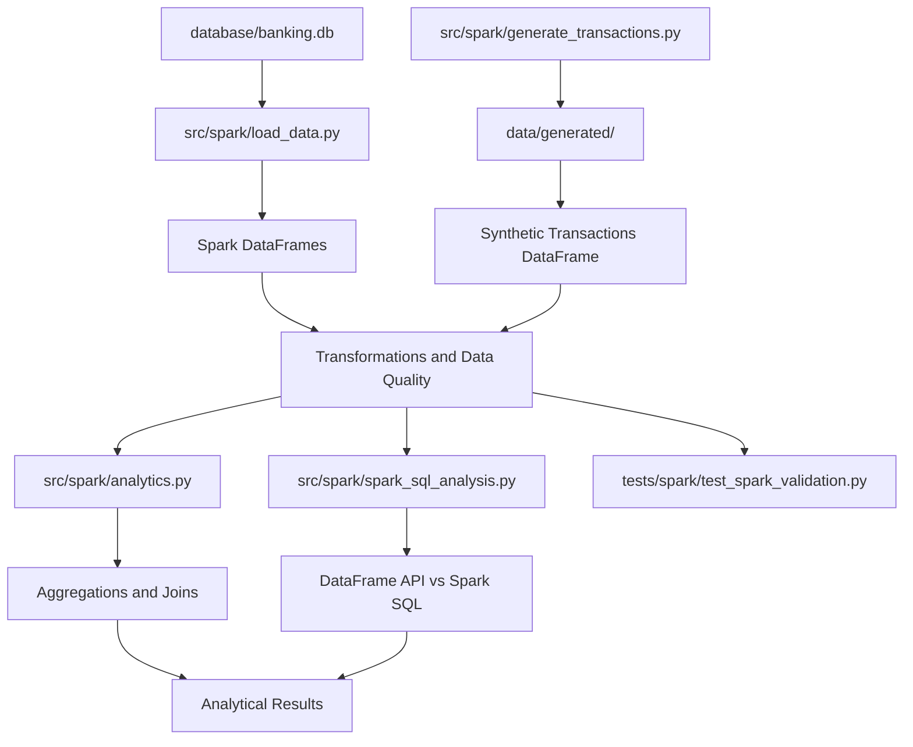

<<<<<<< HEAD
# Banking Data Pipeline — Week 5

A Python-based banking data pipeline that processes transaction data, performs data-quality validation, loads data into a relational SQLite database, handles incremental daily updates, and builds an analytical layer using a star schema.

## Overall Architecture



## Project Structure

```text
banking_data_pipeline/
│
├── config/
│   └── config.py
│
├── data/
│   ├── raw/
│   ├── reference/
│   ├── validated/
│   └── daily/
│
├── database/
│   ├── banking.db
│   └── analytics.db
│
├── docs/
│   ├── analytics/
│   └── erd/
│
├── evidence/
│   ├── class_4/
│   └── week_5/
│
├── output/
│   ├── dq/
│   ├── logs/
│   └── summaries/
│
├── sql/
│   └── operational_queries.sql
│
├── src/
│   ├── ingestion/
│   │   ├── pipeline.py
│   │   ├── validation.py
│   │   └── dq_metrics.py
│   │
│   ├── operational/
│   │   ├── database.py
│   │   ├── schema.sql
│   │   ├── load_data.py
│   │   ├── incremental_load.py
│   │   ├── check_database.py
│   │   └── run_query.py
│   │
│   └── analytics/
│       ├── analytical_queries.sql
│       └── build_analytics.py
│
├── tests/
│   ├── test_incremental_load.py
│   ├── test_analytics.py
│   └── run_analyisis.py
│
├── .gitignore
└── requirements.txt
```

## Main Components

### 1. Ingestion & Validation

Raw transaction CSV files are processed using Python and Pandas.

The pipeline:

- Reads transaction files
- Validates required columns
- Validates transaction values
- Separates valid and invalid records
- Generates data-quality summaries

### 2. Operational Database

The validated transactions are stored in `banking.db`.

Main tables:

```text
branches
customers
accounts
transactions
```

SQLite constraints are used to maintain data integrity.

### 3. Incremental Processing

Daily transaction files are processed without rebuilding the entire database.

The incremental process:

```text
Daily CSV
   ↓
Read transactions
   ↓
Check transaction_id
   ↓
New transaction → INSERT
Corrected transaction → UPDATE
   ↓
Updated banking.db
```

UPSERT logic makes the process rerun-safe.

### 4. Analytical Layer

The trusted operational database is transformed into `analytics.db`.

The analytical model contains:

```text
dim_branch
dim_customer
dim_account
dim_date
      │
      ▼
fact_transaction
```

The fact table stores transaction-level analytical data.

### 5. Analytical SQL

Analytical queries are stored in:

```text
src/analytics/analytical_queries.sql
```

They are used for:

- Branch analysis
- Transaction-type analysis
- Customer analysis
- Account analysis
- Daily analysis
- Transaction classification
- Running totals
- Business questions

## Technologies

- Python
- Pandas
- SQLite
- SQL
- Pytest
- Git & GitHub

## Run the Project

Activate the virtual environment:

```powershell
.venv\Scripts\Activate.ps1
```

Run the ingestion pipeline:

```powershell
py src/ingestion/pipeline.py
```

Load the operational database:

```powershell
py src/operational/database.py
py src/operational/load_data.py
```

Run incremental processing:

```powershell
py src/operational/incremental_load.py
```

Build the analytical database:

```powershell
py src/analytics/build_analytics.py
```

Run tests:

```powershell
py -m pytest -q
```

## Test Result

Current project test result:

```text
11 passed
```

## Data Flow Summary

```text
Raw CSV
  ↓
Ingestion
  ↓
Validation
  ↓
Valid Transactions
  ↓
banking.db
  ↓
Incremental UPSERT
  ↓
Updated Operational Data
  ↓
analytics.db
  ↓
Analytical SQL
  ↓
Business Analysis
```

## 6 Concept Questions

### 1. Why is incremental processing important?

Incremental processing allows the pipeline to process only new or changed data instead of rebuilding the complete dataset every time.

In this project, daily transaction files are processed using incremental loading. New transactions are inserted, while corrected transactions are updated using UPSERT logic.

---

### 2. What happens if the same daily file is processed twice?

The pipeline is designed to be rerun-safe.

When the same transaction is processed again, the existing `transaction_id` is detected and the record is updated instead of creating a duplicate transaction.

Therefore, rerunning the same daily file does not increase the number of transaction records unnecessarily.

---

### 3. Why should the analytical database be built from the operational database instead of raw CSV files?

The operational database contains trusted and validated data.

Building the analytical layer from `banking.db` ensures that the analytical database uses the controlled operational dataset rather than bypassing validation and integrity checks applied to the raw data.

In this project:

```text
Raw CSV
   ↓
Validation
   ↓
banking.db
   ↓
Analytical Transformation
   ↓
analytics.db
```

---

### 4. Why is a star schema useful for analytical queries?

A star schema separates transaction facts from descriptive dimensions.

In this project:

```text
              dim_customer
                   │
                   │
dim_branch ── fact_transaction ── dim_account
                   │
                   │
                dim_date
```

The `fact_transaction` table stores transaction-level data, while the dimension tables provide information about customers, accounts, branches, and dates.

This structure makes analytical queries easier to organize and understand.

---

### 5. What is the grain of the fact table?

The grain of `fact_transaction` is:

> **One row represents one banking transaction identified by `transaction_id`.**

Each fact row connects the transaction to:

- Customer
- Account
- Branch
- Date

This clearly defines what one row in the fact table represents and prevents ambiguity when performing analytical calculations.

## Goal

The project demonstrates a complete small-scale data engineering workflow:

**Ingestion → Validation → Relational Storage → Incremental Processing → Analytical Modeling → SQL Analysis → Testing**
=======
>>>>>>> 573e711 (Extend banking pipeline with Week 6 PySpark)

---

---

# Week 6 — Rebuild the Banking Analytics Pipeline with PySpark

## Overview

Week 6 extends the existing banking data pipeline by introducing Apache Spark through PySpark. The existing SQLite banking database remains the source for banking tables, while synthetic transaction data is used to test Spark transformations and analytical operations at a larger scale.

The objective is to perform data loading, transformations, aggregations, joins, data-quality checks, Spark execution analysis, SQL comparisons, and automated validation using PySpark.

## Week 6 Architecture



## Week 6 Project Structure

```text
data/
└── generated/
    └── synthetic_transactions.csv

src/
└── spark/
    ├── analytics.py
    ├── data_quality.py
    ├── generate_transactions.py
    ├── load_data.py
    ├── spark_session_test.py
    ├── spark_sql_analysis.py
    └── transformations.py

tests/
└── spark/
    └── test_spark_validation.py
```

## Main Components

### 1. Spark Session and Data Loading

**File:** `src/spark/load_data.py`

Loads banking tables from the existing `database/banking.db` into Spark DataFrames for further processing.

### 2. Synthetic Transaction Generation

**File:** `src/spark/generate_transactions.py`

Generates synthetic transaction data for testing Spark operations on a larger dataset without using the actual banking records as test fixtures.

The Week 6 execution processed approximately 100,000 synthetic transactions.

### 3. Transformations

**File:** `src/spark/transformations.py`

Demonstrates DataFrame transformations such as filtering, selecting columns, deriving values, and preparing data for analysis.

### 4. Banking Analytics

**File:** `src/spark/analytics.py`

Performs transaction aggregations, joins, and banking analysis using Spark DataFrames.

### 5. Data Quality Checks

**File:** `src/spark/data_quality.py`

Supports checks for missing values, duplicate transaction identifiers, and invalid relationships between banking entities.

### 6. Spark SQL Comparison

**File:** `src/spark/spark_sql_analysis.py`

Registers the synthetic transaction DataFrame as a temporary view named `synthetic_transactions`.

The same analysis is performed using:

- The PySpark DataFrame API
- Spark SQL

Both methods calculate transaction counts, total amounts, and average amounts grouped by transaction type.

## Part 9 — Spark Execution Concepts

The Spark analytics work demonstrates the following execution concepts:

- **Partitions:** Inspect the number of partitions using `df.rdd.getNumPartitions()`.
- **Transformations:** Operations such as `filter()` define new DataFrames.
- **Actions:** Operations such as `count()` trigger computation and return results.
- **Lazy evaluation:** Spark can defer executing transformations until an action requires the results.
- **Shuffle:** Grouped aggregations may redistribute data across partitions. The physical execution plan can be inspected using `explain()`.

## Part 10 — Spark SQL Comparison

The analysis was performed using both the DataFrame API and Spark SQL on 100,000 synthetic transactions.

| Transaction type | Transaction count | Total amount | Average amount |
|---|---:|---:|---:|
| CREDIT | 49,727 | 124,135,479.93 | 2,496.34 |
| DEBIT | 50,273 | 125,340,750.24 | 2,493.20 |
| **Total** | **100,000** | **249,476,230.17** | — |

**Validation result:**

```text
PASS | PySpark DataFrame and Spark SQL results match.
```

These figures are from the recorded synthetic-data run. They may change if the generated dataset changes.

## Part 11 — Validation and Testing

**Test file:** `tests/spark/test_spark_validation.py`

Validation uses small, controlled, temporary in-memory DataFrames. These tests do not need to read or modify the actual banking database or generated transaction CSV.

Six automated tests were executed:

| Test | Expected result |
|---|---|
| Input row count | 5 temporary transactions |
| CREDIT count | 3 CREDIT transactions |
| Aggregation | CREDIT total equals 450.00 |
| Duplicate transaction ID | Detect duplicate `T001` |
| Null check | Detect one null amount |
| Join integrity | Detect one unmatched account reference |

**Recorded test result:**

```text
6 passed, 1 warning in 34.92s
```

The warning was a pandas compatibility `FutureWarning` emitted by the installed PySpark package. The six tests passed.

### Run the tests

From the project root:

```powershell
py -m pytest tests/spark/test_spark_validation.py -v
```

## Running Week 6 Scripts

Activate the existing virtual environment:

```powershell
.venv\Scripts\Activate.ps1
```

Run the Spark session check:

```powershell
py .\src\spark\spark_session_test.py
```

Generate synthetic transactions:

```powershell
py .\src\spark\generate_transactions.py
```

Run the Spark SQL comparison:

```powershell
py .\src\spark\spark_sql_analysis.py
```

Run the Part 11 validation tests:

```powershell
py -m pytest tests/spark/test_spark_validation.py -v
```

Run each script from the project root and verify its expected input paths before execution.

## Parquet Output and Windows Limitation

The assignment includes writing Spark results to Parquet and reading them back to validate the row count when local support is available.

During execution on Windows, the Parquet write encountered a Hadoop configuration error because `winutils.exe` was unavailable and `HADOOP_HOME` / `hadoop.home.dir` were unset.

A successful Parquet round trip has not been confirmed. If this limitation remains, document the error and retain execution evidence in `evidence/week6/`, in line with the assignment instructions.

## Week 6 Learning Outcomes

After completing Week 6, the project demonstrates:

1. Loading relational banking data into Spark DataFrames.
2. Performing transformations, filtering, joins, and aggregations.
3. Generating synthetic data for larger-scale processing.
4. Applying data-quality checks.
5. Understanding partitions, lazy evaluation, and shuffle operations.
6. Comparing the DataFrame API with Spark SQL.
7. Testing validation logic with temporary in-memory datasets.
8. Documenting environment limitations and repeatable test results.

## Overall Project Goal

The complete project now extends the original workflow:

**Ingestion → Validation → Relational Storage → Incremental Processing → Analytical Modeling → SQL Analysis → PySpark Processing → Data Quality → Automated Testing**