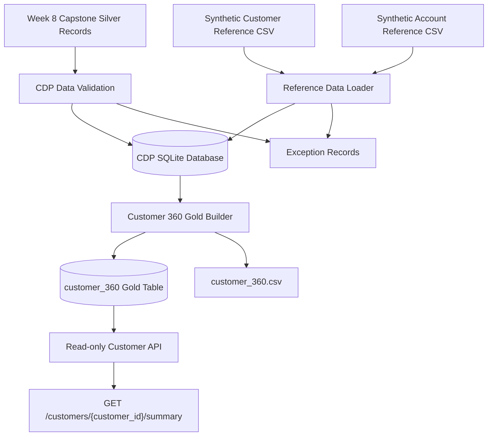

# CDP Readiness Extension – Architecture

## 1. Overview

This project extends the Week 8 Banking Data Pipeline Capstone by creating a customer-level Gold data product and a read-only API.

The solution reuses trusted Silver transaction data from the existing capstone. It does not modify the original capstone implementation.

## 2. Architecture Flow

## 3. Data Sources

### 3.1 Silver Transactions

Source database: `capstone/database/capstone.db`

Source table: `silver_records`

The CDP extension reads trusted transaction records and loads the required fields into its own SQLite database.

### 3.2 Customer Reference Data

File: `cdp/data/reference/customers.csv`

Contains synthetic customer identifiers and names.

### 3.3 Account Reference Data

File: `cdp/data/reference/accounts.csv`

Contains synthetic account identifiers and their customer relationships.

## 4. Data Model

| Table | Grain | Purpose |
|---|---|---|
| customers | One row per customer | Customer identity |
| accounts | One row per account | Customer-account relationship |
| transactions | One row per transaction | Validated transaction data |
| exception_records | One row per rejected record | Data-quality evidence |
| customer_360 | One row per customer | Customer-level Gold summary |

### Relationships

- One customer can have multiple accounts.
- One account can have multiple transactions.
- Every account must reference a known customer.
- Every transaction must reference a known account.
- Customers without accounts or transactions remain in Customer 360.

## 5. Data Processing

### Step 1 – Reference Data Loading

File: `src/load_reference_data.py`

- Loads synthetic customers and accounts.
- Checks required fields and duplicate identifiers.
- Checks account-to-customer relationships.
- Records invalid records in the exception table.

### Step 2 – Silver Data Validation and Loading

File: `src/validate_data.py`

- Reads trusted Silver records from the Week 8 capstone database.
- Checks required transaction fields.
- Checks duplicate transaction identifiers.
- Checks whether referenced accounts exist.
- Loads accepted records into the CDP database.
- Records rejected records with reasons.

### Step 3 – Customer 360 Gold Build

File: `src/build_customer360.py`

- Aggregates account metrics separately from transaction metrics.
- Joins the aggregated results to the customer table.
- Produces exactly one Gold row per customer.
- Preserves customers with no transactions.
- Exports the result to `output/gold/customer_360.csv`.

Separate account and transaction aggregations prevent join fan-out and inflated totals.

### Step 4 – Read-only API

File: `src/api_server.py`

Endpoint: `GET /customers/{customer_id}/summary`

- Existing customer: HTTP 200.
- Unknown customer: HTTP 404.
- Unsupported write methods: HTTP 405.

The API binds to `127.0.0.1` and uses a parameterized SQL query.

## 6. Exception Handling

Invalid records are retained as exception evidence in `exception_records`.

Examples include:

- Missing required fields.
- Duplicate transaction identifiers.
- Unknown account references.
- Unknown customer references in account data.

Rejected records are not included in Customer 360 Gold calculations.

## 7. Technology Stack

- Python
- SQLite
- SQL
- CSV
- Built-in Python HTTP server
- Pytest

## 8. Reproducibility

The Customer 360 Gold table is rebuilt from the validated CDP database.

The build process replaces the previous Gold result instead of appending duplicate summary rows.

Rerun-safety tests verify that repeated execution produces identical business results when the source data has not changed.

## 9. Security and Scope

This is a local, synthetic-data demonstration.

- No real customer personal information is used.
- The API is read-only.
- The API binds to localhost.
- SQL parameters are used for customer lookups.
- No authentication, authorization, or production deployment is implemented.

Production controls and limitations are documented separately in `PRIVACY_AND_DESIGN.md`.
